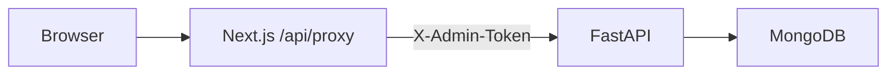

# AcmeCorp Accounts (Sonic AI Intern Assignment)

Collections agent + bank reconciliation take-home. **Phase 1–2 complete** (base API + Part A UI). Parts B/C follow later.

## Ports & CORS

| Service  | URL                       |
|----------|---------------------------|
| Backend  | http://localhost:8000     |
| Frontend | http://localhost:3000     |
| MongoDB  | mongodb://localhost:27017 |

Backend CORS (`FRONTEND_ORIGIN`) allows **only** the frontend origin (default `http://localhost:3000`). The browser never calls the backend directly: the Next.js server proxy (`/api/proxy/*`) forwards allowlisted routes and injects `X-Admin-Token`.

## Prerequisites

- Docker (MongoDB)
- Python 3.12+
- Node.js 20+

## Quick start

### 1. Environment

```bash
cp .env.example .env
# Set ADMIN_API_TOKEN (dev default is fine locally).
# Optional: DEMO_TODAY=2026-11-05 for reproducible overdue badges.

cp frontend/.env.example frontend/.env.local
# BACKEND_URL=http://localhost:8000
# ADMIN_TOKEN must match backend ADMIN_API_TOKEN
```

**Security notes**

- Never use `NEXT_PUBLIC_` for `ADMIN_TOKEN` or `BACKEND_URL`.
- If `ENV=production` and `ADMIN_API_TOKEN` is a default/placeholder (or &lt; 16 chars), the backend **refuses to start**.

### 2. MongoDB

```bash
docker compose up -d
```

### 3. Backend

```bash
cd backend
python3 -m venv .venv
source .venv/bin/activate
pip install -r requirements.txt
python -m app.scripts.seed
uvicorn app.main:app --reload --port 8000
```

API docs: http://localhost:8000/docs

### 4. Frontend

```bash
cd frontend
npm install
npm run dev
```

Open http://localhost:3000

### 5. Tests (backend)

```bash
cd backend
source .venv/bin/activate
pytest -v
```

## Env var table (current)

| Variable | Where | Purpose |
|----------|-------|---------|
| `ENV` | backend `.env` | `development` / `production` |
| `MONGODB_URI` | backend | Mongo connection |
| `MONGODB_DB` | backend | Database name |
| `ADMIN_API_TOKEN` | backend | Required on mutating routes (`X-Admin-Token`) |
| `FRONTEND_ORIGIN` | backend | CORS allowlist (exact origin) |
| `DEMO_TODAY` | backend | Optional `YYYY-MM-DD` clock override |
| `BACKEND_URL` | frontend `.env.local` (server-only) | FastAPI base URL for proxy |
| `ADMIN_TOKEN` | frontend `.env.local` (server-only) | Injected as `X-Admin-Token` by proxy |

SMTP/IMAP/LLM vars are reserved for Part B (see root `.env.example`).

## Part A pages

- **Organization** — contacts, bank, policies, payment terms
- **Customers** — table + inline email edit (validated client + server)
- **Invoices** — status / OVERDUE badges, filters, detail drawer; amounts use API `formatted` strings
- **Collections / Reconciliation** — placeholder routes
- Header: today from `/health`, demo-date tag, confirm-gated **Reset demo data**

## Architecture (so far)



## Status

| Area | Status |
|------|--------|
| Part A API + seed/reset | Done |
| Part A frontend | Done |
| Part C reconciliation | Not started |
| Part B collections agent | Not started |
| Full README / explanation.pdf / video | Later phase |
