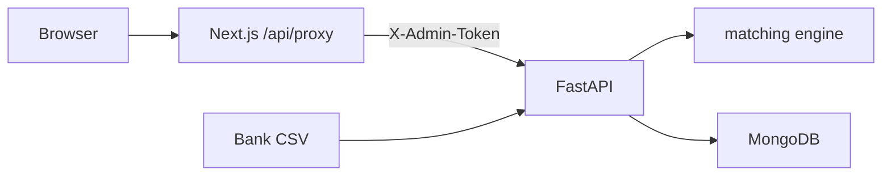

# AcmeCorp Accounts (Sonic AI Intern Assignment)

Collections agent + bank reconciliation take-home. **Phases 1–3 complete** (base app + Part C reconciliation). Part B follows later.

## Ports & CORS

| Service  | URL                       |
|----------|---------------------------|
| Backend  | http://localhost:8000     |
| Frontend | http://localhost:3000     |
| MongoDB  | mongodb://localhost:27017 |

Backend CORS (`FRONTEND_ORIGIN`) allows **only** the frontend origin (default `http://localhost:3000`). The browser never calls the backend directly: the Next.js server proxy (`/api/proxy/*`) forwards allowlisted routes and injects `X-Admin-Token`.

## Prerequisites

- Docker (MongoDB)
- Python 3.12+
- Node.js 20+

## Quick start

### 1. Environment

```bash
cp .env.example .env
# Set ADMIN_API_TOKEN (dev default is fine locally).
# Optional: DEMO_TODAY=2026-11-05 for reproducible overdue badges.

cp frontend/.env.example frontend/.env.local
# BACKEND_URL=http://localhost:8000
# ADMIN_TOKEN must match backend ADMIN_API_TOKEN
```

**Security notes**

- Never use `NEXT_PUBLIC_` for `ADMIN_TOKEN` or `BACKEND_URL`.
- If `ENV=production` and `ADMIN_API_TOKEN` is a default/placeholder (or < 16 chars), the backend **refuses to start**.

### 2. MongoDB

```bash
docker compose up -d
```

### 3. Backend

```bash
cd backend
python3 -m venv .venv
source .venv/bin/activate
pip install -r requirements.txt
python -m app.scripts.seed
uvicorn app.main:app --reload --port 8000
```

API docs: http://localhost:8000/docs

### 4. Frontend

```bash
cd frontend
npm install
npm run dev
```

Open http://localhost:3000

### 5. Tests (backend)

```bash
cd backend
source .venv/bin/activate
pytest -v -s   # -s prints the matching evaluation table
```

## Env var table

| Variable | Where | Purpose |
|----------|-------|---------|
| `ENV` | backend `.env` | `development` / `production` |
| `MONGODB_URI` | backend | Mongo connection |
| `MONGODB_DB` | backend | Database name |
| `ADMIN_API_TOKEN` | backend | Required on mutating routes (`X-Admin-Token`) |
| `FRONTEND_ORIGIN` | backend | CORS allowlist (exact origin) |
| `DEMO_TODAY` | backend | Optional `YYYY-MM-DD` clock override |
| `ENABLE_EMBEDDINGS` | backend | Optional MiniLM name similarity (default off) |
| `ENABLE_LLM_MATCH_ASSIST` | backend | Optional LLM for ambiguous leftovers (default off) |
| `BACKEND_URL` | frontend `.env.local` (server-only) | FastAPI base URL for proxy |
| `ADMIN_TOKEN` | frontend `.env.local` (server-only) | Injected as `X-Admin-Token` by proxy |

SMTP/IMAP/LLM email vars are reserved for Part B (see root `.env.example`).

## Reconciliation API examples

All mutating routes require header `X-Admin-Token: <ADMIN_API_TOKEN>`.

### Upload

```bash
curl -s -X POST http://localhost:8000/api/v1/reconciliation/upload \
  -H "X-Admin-Token: $ADMIN_API_TOKEN" \
  -F "file=@data/bank_statement_sample.csv"
```

Response:

```json
{
  "statement_id": "stmt_…",
  "filename": "bank_statement_sample.csv",
  "row_count": 14,
  "error_count": 0,
  "parse_errors": [],
  "suggestion_count": 12
}
```

### Statement detail

```bash
curl -s http://localhost:8000/api/v1/reconciliation/statements/{id} \
  -H "X-Admin-Token: $ADMIN_API_TOKEN"
```

Returns statement metadata, `parse_errors`, `transactions[]` (each with nested `suggestion`), and `suggestions[]`.

### Approve / reject / choose

```bash
# Exact / multi payment
curl -s -X POST http://localhost:8000/api/v1/reconciliation/suggestions/{id}/approve \
  -H "X-Admin-Token: $ADMIN_API_TOKEN" -H "Content-Type: application/json" \
  -d '{}'

# Partial: leave open or close with TDS (INR, shortfall == 10% of subtotal)
curl -s -X POST …/approve -H "…" -d '{"tds_mode":"leave_open"}'
curl -s -X POST …/approve -H "…" -d '{"tds_mode":"close_tds"}'

curl -s -X POST …/reject -H "X-Admin-Token: $ADMIN_API_TOKEN" -d '{}'

curl -s -X POST …/choose -H "…" -d '{"invoice_numbers":["INV-1002"]}'
# Choose only updates the suggestion; Approve still required to apply.
```

Second approve of the same suggestion or the same bank transaction → **409**.

### Open invoices (dropdown)

```bash
curl -s http://localhost:8000/api/v1/invoices/open -H "X-Admin-Token: $ADMIN_API_TOKEN"
```

## Matching design (summary)

Local fuzzy pipeline (no statement → LLM). Weights/thresholds live in `backend/app/services/matching/config.py`.

1. Normalize narration → payer candidate + invoice hints  
2. Alias generation (legal-suffix strip, abbreviations, contact initials)  
3. Similarity: token_set_ratio + Jaro-Winkler + char n-gram TF-IDF cosine  
4. Candidates: open invoices only; multi-invoice subset-sum (same customer/currency)  
5. Hard gates: unknown payer + no invoice # → none; amount-alone → none; wrong currency → none; payment before invoice_date → reject; confidence &lt; 60 → none  
6. Overpayment never auto-suggested (Choose + Approve can still be used carefully; approve rejects overpay)

TDS: **10% of invoice subtotal**, **INR only**.

## Architecture



## Known limitations

- **Overpayment is refused; no unapplied-credit ledger.** Approving a credit larger than the selected invoice outstanding returns 400. There is no suspense/unapplied-cash account.
- Cross-upload duplicates use a fingerprint; only **applied** fingerprints block re-application. Unapplied re-uploads may be suggested again.
- Optional embeddings / LLM match assist are off by default and not required for grading.
- Collections agent (Part B) email/LLM paths need real SMTP/IMAP credentials for live demos; tests use fakes + `EMAIL_DRY_RUN`.

## Status

| Area | Status |
|------|--------|
| Part A API + seed/reset | Done |
| Part A frontend | Done |
| Part C matching + API + review UI | Done |
| Part B collections agent | In progress |
| explanation.pdf / video | Later phase |
