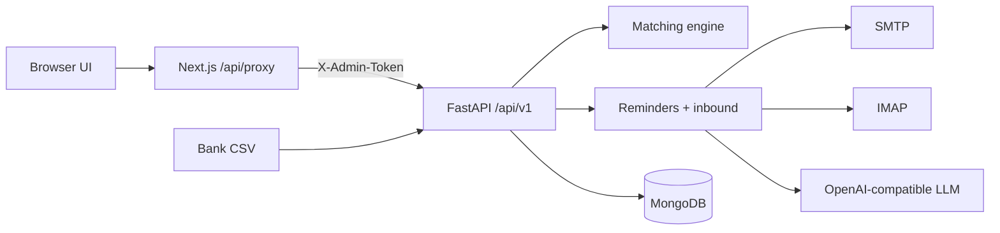

# AcmeCorp Accounts (Sonic AI Intern Assignment)

Take-home: **Part A** (org / customers / invoices), **Part B** (collections agent), **Part C** (bank reconciliation). Stack: FastAPI + Motor/MongoDB + Next.js App Router.

## Architecture



- Browser never holds `ADMIN_TOKEN` or `BACKEND_URL`.
- Money is stored as **integer minor units**; display uses `format_money`.
- “Today” for overdue uses `DEMO_TODAY` when set (else real local date).

## Run from scratch (clean clone)

Tested path on Linux with Docker + Python 3.12 + Node 20:

```bash
git clone <this-repo> && cd Sonic-AI-Intern-Assignment

# 1) Env
cp .env.example .env
# Optional but recommended for demos:
#   DEMO_TODAY=2026-11-05
#   ADMIN_API_TOKEN=<long random string>

cp frontend/.env.example frontend/.env.local
# BACKEND_URL=http://localhost:8000
# ADMIN_TOKEN must equal ADMIN_API_TOKEN. Both examples ship with the same
# placeholder so this works as-is; if you change one, change the other
# (a mismatch shows as 401 in the UI and a warning in the Next.js console).

# 2) Mongo
docker compose up -d

# 3) Backend
cd backend
python3 -m venv .venv
source .venv/bin/activate
pip install -r requirements.txt
python -m app.scripts.seed
uvicorn app.main:app --reload --port 8000
# API docs: http://localhost:8000/docs

# 4) Frontend (new terminal)
cd frontend
npm install
npm run dev
# UI: http://localhost:3000
```

Health check:

```bash
curl -s http://localhost:8000/api/v1/health | jq
```

## Env var table

| Variable | Where | Purpose | Default |
|----------|-------|---------|---------|
| `ENV` | backend | `development` / `production` | `development` |
| `MONGODB_URI` | backend | Mongo URI | `mongodb://localhost:27017` |
| `MONGODB_DB` | backend | DB name | `acmecorp` |
| `ADMIN_API_TOKEN` | backend | Mutating API auth (`X-Admin-Token`) | `dev-admin-token` |
| `FRONTEND_ORIGIN` | backend | Exact CORS origin | `http://localhost:3000` |
| `DEMO_TODAY` | backend | Optional `YYYY-MM-DD` clock | unset |
| `SMTP_HOST` / `SMTP_PORT` | backend | Outbound SMTP | Gmail 587 |
| `SMTP_USER` / `SMTP_PASSWORD` | backend | Org mailbox + app password | empty |
| `IMAP_HOST` / `IMAP_PORT` | backend | Inbound IMAP | Gmail 993 |
| `IMAP_USER` / `IMAP_PASSWORD` | backend | Same org mailbox | empty |
| `EMAIL_FROM_NAME` | backend | From display name | AcmeCorp Accounts Team |
| `EMAIL_DRY_RUN` | backend | `true` → Mongo `email_outbox` only | `true` |
| `REMINDER_COOLDOWN_HOURS` | backend | Reminder anti-spam | `72` |
| `ENABLE_REMINDER_SCHEDULER` | backend | Daily reminder job | `false` |
| `ENABLE_INBOX_POLL` | backend | IMAP poll loop | `false` |
| `INBOX_POLL_SECONDS` | backend | Poll interval | `120` |
| `LLM_PROVIDER` | backend | Provider label (only `openai_compatible` is implemented) | `openai_compatible` |
| `LLM_API_KEY` / `LLM_BASE_URL` / `LLM_MODEL` | backend | OpenAI-compatible chat (see *Changing the LLM*) | Gemini URL + `gemini-3.6-flash` |
| `LLM_MIN_CONFIDENCE` | backend | Below → Needs attention | `0.75` |
| `MAX_EMAIL_BODY_CHARS` | backend | Body size cap | `12000` |
| `ENABLE_EMBEDDINGS` | backend | Optional MiniLM; needs `pip install -r requirements-embeddings.txt` | `false` |
| `ENABLE_LLM_MATCH_ASSIST` | backend | Optional LLM match assist | `false` |
| `MATCH_USE_EMBEDDINGS` / `MATCH_USE_LLM` | backend | Aliases of `ENABLE_EMBEDDINGS` / `ENABLE_LLM_MATCH_ASSIST` | `false` |
| `BACKEND_URL` | frontend `.env.local` | Proxy upstream | — |
| `ADMIN_TOKEN` | frontend `.env.local` | Injected by proxy | — |

**Production:** `ENV=production` refuses default/short `ADMIN_API_TOKEN`.

## Gmail setup (two accounts)

1. **Org mailbox** → App Password → `SMTP_*` / `IMAP_*`.
2. **Customer mailbox** → set a seed customer’s `contact_email` to that address (Customers page).
3. Set `EMAIL_DRY_RUN=false` only when ready to send for real.
4. Configure `LLM_API_KEY` (+ base URL/model as needed). See *Changing the LLM* below.

### Changing the LLM

The agent talks to any OpenAI-compatible `/chat/completions` endpoint. Three variables in `.env` (restart the backend after editing):

```bash
LLM_BASE_URL=https://generativelanguage.googleapis.com/v1beta/openai/   # Gemini default
LLM_MODEL=gemini-3.6-flash
LLM_API_KEY=<your key>
```

Provider model names are retired regularly (the previous default, `gemini-2.0-flash`, was shut down on 1 June 2026), so check your provider's current model list if you get a 404/`model not found`. For another provider, set all three, e.g. OpenAI: `LLM_BASE_URL=https://api.openai.com/v1`, `LLM_MODEL=<a current chat model>`. The model must be able to return JSON (`response_format: json_object`). Any LLM error sends the email to Needs attention rather than failing silently.

## How to run tests

```bash
cd backend
source .venv/bin/activate
pytest -v -s
# Matching tables + mutation stress:
pytest tests/test_matching_eval.py tests/test_matching_holdout.py tests/test_matching_mutation.py -s
```

Requires Mongo on `localhost:27017` (`docker compose up -d`).

## API reference (examples)

Set the token once in your shell (same value as `ADMIN_API_TOKEN` in `.env`):

```bash
export ADMIN_API_TOKEN=change-me-to-a-long-random-string
```

Every `/api/v1` route except `/health` needs `X-Admin-Token: $ADMIN_API_TOKEN` (the Next.js proxy adds it for the UI).

### Part A

```bash
curl -s http://localhost:8000/api/v1/organization -H "X-Admin-Token: $ADMIN_API_TOKEN" | jq
curl -s http://localhost:8000/api/v1/customers -H "X-Admin-Token: $ADMIN_API_TOKEN" | jq 'length'
curl -s 'http://localhost:8000/api/v1/invoices?overdue_only=true' -H "X-Admin-Token: $ADMIN_API_TOKEN" | jq '.[].invoice_number'
curl -s -X PATCH http://localhost:8000/api/v1/customers/C002 \
  -H "X-Admin-Token: $ADMIN_API_TOKEN" -H "Content-Type: application/json" \
  -d '{"contact_email":"you@gmail.com"}'
curl -s -X POST http://localhost:8000/api/v1/admin/reset \
  -H "X-Admin-Token: $ADMIN_API_TOKEN" -H "Content-Type: application/json" \
  -d '{"confirm":"RESET"}'
```

### Reconciliation (Part C)

Run from the repo root, with `ADMIN_API_TOKEN` exported (see above). Each suggestion can be approved once; call `admin/reset` to start over.

```bash
API=http://localhost:8000/api/v1
H="X-Admin-Token: $ADMIN_API_TOKEN"

# 1) Upload the sample statement; keep the statement id
STMT=$(curl -s -X POST $API/reconciliation/upload -H "$H" \
  -F "file=@data/bank_statement_sample.csv" | jq -r .statement_id)

# 2) Review: row, suggested invoice(s), confidence, reason
curl -s $API/reconciliation/statements/$STMT -H "$H" \
  | jq -r '.suggestions[] | "\(.row_number)\t\(.suggestion_type)\t\(.invoice_numbers|join(","))\t\(.confidence)\t\(.suggestion_id)\t\(.reason)"'

# helper: suggestion id for a suggested invoice list, e.g. sug INV-1004
sug() { curl -s $API/reconciliation/statements/$STMT -H "$H" \
  | jq -r --arg n "$1" '.suggestions[] | select((.invoice_numbers|join(","))==$n) | .suggestion_id'; }

# 3a) Approve an exact match (INV-1004 -> paid)
curl -s -X POST $API/reconciliation/suggestions/$(sug INV-1004)/approve \
  -H "$H" -H "Content-Type: application/json" -d '{}' | jq

# 3b) Partial payment: first call answers 422 tds_choice_required, then choose
curl -s -X POST $API/reconciliation/suggestions/$(sug INV-1013)/approve \
  -H "$H" -H "Content-Type: application/json" -d '{}' | jq
curl -s -X POST $API/reconciliation/suggestions/$(sug INV-1013)/approve \
  -H "$H" -H "Content-Type: application/json" -d '{"tds_mode":"leave_open"}' | jq

# 3c) Shortfall equal to 10% of subtotal (INR only): close the invoice with TDS
curl -s -X POST $API/reconciliation/suggestions/$(sug INV-1007)/approve \
  -H "$H" -H "Content-Type: application/json" -d '{"tds_mode":"close_tds"}' | jq

# 3d) One payment, several invoices (split on approve)
curl -s -X POST $API/reconciliation/suggestions/$(sug INV-1010,INV-1011,INV-1012)/approve \
  -H "$H" -H "Content-Type: application/json" -d '{}' | jq

# 4) Reject a suggestion, or manually choose a different invoice (then approve it)
curl -s -X POST $API/reconciliation/suggestions/$(sug INV-1016)/reject -H "$H" | jq
SUG_NONE=$(curl -s $API/reconciliation/statements/$STMT -H "$H" \
  | jq -r '[.suggestions[] | select(.status=="pending" and .suggestion_type=="none")][0].suggestion_id')
curl -s -X POST $API/reconciliation/suggestions/$SUG_NONE/choose \
  -H "$H" -H "Content-Type: application/json" -d '{"invoice_numbers":["INV-1002"]}' | jq
```

Cross-upload fingerprint already applied → **409**.

### Collections (Part B)

```bash
API=http://localhost:8000/api/v1
H="X-Admin-Token: $ADMIN_API_TOKEN"

curl -s -X POST $API/collections/reminders/send -H "$H" | jq
curl -s -X POST $API/collections/inbox/check -H "$H" | jq
curl -s $API/collections/conversations -H "$H" | jq 'length'

# Needs attention: list, pick the first item, edit its draft, send or dismiss it.
# (If the list is empty, reply to a reminder from the customer inbox with
#  "Can we get two more weeks to pay?" and run inbox/check again.)
curl -s $API/collections/needs-attention -H "$H" | jq '.[] | {conversation_id, needs_attention_reason}'
CONV=$(curl -s $API/collections/needs-attention -H "$H" | jq -r '.[0].conversation_id')

curl -s -X PATCH $API/collections/needs-attention/$CONV \
  -H "$H" -H "Content-Type: application/json" \
  -d '{"draft":"Dear customer, thank you for your message. Our Accounts Team will review it and reply shortly."}' | jq

# Send: 200 on a clean draft. If the draft fails validation you get 409
# "validation_warnings"; add "acknowledge_warnings": true to override knowingly.
curl -s -X POST $API/collections/needs-attention/$CONV/send \
  -H "$H" -H "Content-Type: application/json" -d '{}' | jq
curl -s -X POST $API/collections/needs-attention/$CONV/send \
  -H "$H" -H "Content-Type: application/json" -d '{"acknowledge_warnings":true}' | jq

curl -s -X POST $API/collections/needs-attention/$CONV/dismiss -H "$H" | jq
```

## Design decisions & assumptions

1. **Money:** major units only at the JSON seed boundary; runtime is minor ints + `Decimal` math.
2. **Matching is local-first:** fuzzy aliases + amount/date gates; no statement → LLM. Prefer **no match** over a wrong match.
3. **TDS:** 10% of **subtotal**, **INR only**, decided at approve time (`close_tds` / `leave_open`).
4. **Overpayment:** refused; no unapplied-credit ledger.
5. **Fingerprint:** `sha256(date|narration|amount_minor|reference|currency)` blocks re-application across uploads.
6. **Collections:** facts (invoice lines, bank details) rendered by code templates; LLM writes prose only; deterministic validator is the last gate.
7. **Safety before LLM:** auto-replies/bounces, legal/dispute/extension/other-company keywords; LLM may only add caution.
8. **Unknown senders:** Needs attention, no company data in LLM context.
9. **Payment claims never mark invoices paid** — notes + optional evidence for reconciliation only.
10. **`DEMO_TODAY=2026-11-05`** assumed for seed overdue behaviour in demos/tests.

## Known limitations

- **Overpayment is refused; no unapplied-credit ledger.**
- Fingerprint blocks only **applied** rows; unapplied re-uploads may be re-suggested.
- Email evidence boost is capped (+5) and cannot create a match alone.
- Human Needs attention → Send is blocked on validator failures until the operator confirms (`acknowledge_warnings`); then it sends and logs the warnings.
- Schedulers off by default; Gmail IMAP can lag (click Check inbox again).
- `EMAIL_DRY_RUN=true` writes outbox docs instead of SMTP.
- Optional embeddings / LLM match assist are off and unused for grading.
- Single-process rate limits (not shared across replicas).
- The Next.js proxy has no login: anyone who can reach port 3000 acts as the operator (cross-origin writes are blocked, but put real auth in front for anything beyond a demo).
- Sender identity is the `From:` address only (no SPF/DKIM check); replies always go to the stored `contact_email`, never to the sender or `Reply-To`.
- Reminder bodies are rendered from DB values and not re-run through the validator.
- Two genuinely identical receipts (same date, narration, amount, reference) share a fingerprint, so the second cannot be approved.
- A crash in the middle of an approval (no transactions) can leave a suggestion in `approving`; the invoice update itself is compare-and-set guarded.
- A second approve of the same suggestion returns 409 instead of replaying the first result (it never double-applies).
- CSV: only `,` delimiter and the date formats in `statement_parser.py`; amounts with currency symbols become row errors.
- Uploads are read into memory before the 2 MB cap is enforced; SMTP STARTTLS does not pin/verify certificates beyond Python defaults; IMAP/SMTP calls are synchronous inside async handlers.
- The inbox lock has a 120 s TTL with no heartbeat.
- Layering: `routes/collections.py` builds the SMTP/IMAP/LLM clients itself, and some services touch `db.messages` / `db.audit_log` directly.
- If SMTP succeeds but the follow-up DB write fails, a retry can resend that one reply.

## Finished / not finished

| Area | Status |
|------|--------|
| Part A API + seed/reset + UI | **Finished** |
| Part C matching + API + review UI + fingerprint + holdout eval | **Finished** |
| Part B reminders + inbound + Needs attention UI + tests | **Finished** |
| Security checklist + regression tests | **Finished** |
| Bonus: payment-email ↔ statement evidence | **Finished** (capped boost) |
| README (this file) | **Finished** |
| `docs/explanation.md` + `docs/explanation.pdf` | **Finished** (`python scripts/build_explanation_pdf.py`) |
| `docs/video-script.md` | **Finished** |
| Live two-Gmail soak beyond dry-run | **Operator-dependent** (credentials) |

## Matching (short)

Weights/thresholds: `backend/app/services/matching/config.py`.

1. Normalize narration → payer + invoice hints  
2. Alias generation (legal suffix, abbreviations, contact initials)  
3. Similarity: token_set_ratio + Jaro-Winkler + char n-gram TF-IDF  
4. Candidates: open invoices; multi-invoice subset-sum (same customer/currency)  
5. Hard gates: unknown payer + no invoice # → none; amount-alone → none; wrong currency → none; payment before invoice_date → reject; conf &lt; 60 → none  
6. Soft top-3 alternatives on `none` for the reviewer  

**Self-authored eval sets:** held-out adversarial CSV `backend/tests/fixtures/eval_holdout.csv` (+ labels) and the mutation stress suite were written without peeking at thresholds.

**Stress test (mutations, seed 20261105):** 46 correct base rows → 261 mutations → **249 same / 12 none / 0 wrong**. Exact-tie siblings (same customer + amount, no unique hint) return type **none** with reason `ambiguous between INV-X/INV-Y` and both invoices in alternatives (`AMBIGUOUS_CONFIDENCE_CAP=59` &lt; review 60). Explicit invoice hints still resolve normally. Contact-name gate may relax to 80 only with exact/TDS amount, ≥10pt margin over the second-best customer, and confidence capped below the high band.
