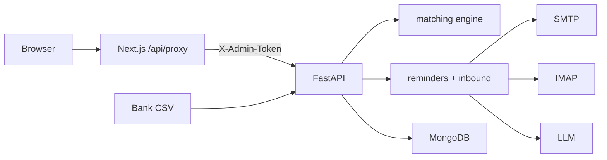

# AcmeCorp Accounts (Sonic AI Intern Assignment)

Collections agent (Part B) + bank reconciliation (Part C) take-home on FastAPI + MongoDB + Next.js.

## Ports & CORS

| Service  | URL                       |
|----------|---------------------------|
| Backend  | http://localhost:8000     |
| Frontend | http://localhost:3000     |
| MongoDB  | mongodb://localhost:27017 |

Backend CORS (`FRONTEND_ORIGIN`) allows **only** the frontend origin (default `http://localhost:3000`). The browser never calls the backend directly: the Next.js server proxy (`/api/proxy/*`) forwards allowlisted routes and injects `X-Admin-Token`.

## Prerequisites

- Docker (MongoDB)
- Python 3.12+
- Node.js 20+

## Quick start

### 1. Environment

```bash
cp .env.example .env
# Set ADMIN_API_TOKEN (dev default is fine locally).
# Optional: DEMO_TODAY=2026-11-05 for reproducible overdue badges.

cp frontend/.env.example frontend/.env.local
# BACKEND_URL=http://localhost:8000
# ADMIN_TOKEN must match backend ADMIN_API_TOKEN
```

**Security notes**

- Never use `NEXT_PUBLIC_` for `ADMIN_TOKEN` or `BACKEND_URL`.
- If `ENV=production` and `ADMIN_API_TOKEN` is a default/placeholder (or < 16 chars), the backend **refuses to start**.

### 2. MongoDB

```bash
docker compose up -d
```

### 3. Backend

```bash
cd backend
python3 -m venv .venv
source .venv/bin/activate
pip install -r requirements.txt
python -m app.scripts.seed
uvicorn app.main:app --reload --port 8000
```

API docs: http://localhost:8000/docs

### 4. Frontend

```bash
cd frontend
npm install
npm run dev
```

Open http://localhost:3000

### 5. Tests (backend)

```bash
cd backend
source .venv/bin/activate
pytest -v -s   # -s prints matching evaluation tables
```

## Env var table

| Variable | Where | Purpose |
|----------|-------|---------|
| `ENV` | backend `.env` | `development` / `production` |
| `MONGODB_URI` | backend | Mongo connection |
| `MONGODB_DB` | backend | Database name |
| `ADMIN_API_TOKEN` | backend | Required on mutating routes (`X-Admin-Token`) |
| `FRONTEND_ORIGIN` | backend | CORS allowlist (exact origin) |
| `DEMO_TODAY` | backend | Optional `YYYY-MM-DD` clock override |
| `ENABLE_EMBEDDINGS` | backend | Optional MiniLM name similarity (default off) |
| `ENABLE_LLM_MATCH_ASSIST` | backend | Optional LLM for ambiguous leftovers (default off) |
| `SMTP_HOST` / `SMTP_PORT` | backend | Outbound SMTP (Gmail: `smtp.gmail.com:587`) |
| `SMTP_USER` / `SMTP_PASSWORD` | backend | Org mailbox + app password |
| `IMAP_HOST` / `IMAP_PORT` | backend | Inbound IMAP (Gmail: `imap.gmail.com:993`) |
| `IMAP_USER` / `IMAP_PASSWORD` | backend | Same org mailbox + app password |
| `EMAIL_FROM_NAME` | backend | Display name on outbound mail |
| `EMAIL_DRY_RUN` | backend | `true` (default): write to `email_outbox` instead of SMTP |
| `REMINDER_COOLDOWN_HOURS` | backend | Skip re-reminder within N hours (default 72) |
| `ENABLE_REMINDER_SCHEDULER` | backend | Optional daily reminder job (default off) |
| `ENABLE_INBOX_POLL` | backend | Optional IMAP poll loop (default off) |
| `INBOX_POLL_SECONDS` | backend | Poll interval when enabled (default 120) |
| `LLM_API_KEY` / `LLM_BASE_URL` / `LLM_MODEL` | backend | OpenAI-compatible chat completions |
| `LLM_MIN_CONFIDENCE` | backend | Below this → Needs attention (default 0.75) |
| `MAX_EMAIL_BODY_CHARS` | backend | Cap inbound/outbound body size |
| `BACKEND_URL` | frontend `.env.local` (server-only) | FastAPI base URL for proxy |
| `ADMIN_TOKEN` | frontend `.env.local` (server-only) | Injected as `X-Admin-Token` by proxy |

## Gmail setup (two accounts for live demo)

Use **two Gmail accounts**:

1. **Org mailbox** (`SMTP_USER` / `IMAP_USER`) — AcmeCorp Accounts Team. Receives customer replies; sends reminders/auto-answers.
2. **Customer mailbox** — e.g. set a seed customer’s `contact_email` (via Customers page or Mongo) to this address so reminders/replies reach you.

### App passwords

1. Enable 2-Step Verification on each Google account.
2. Google Account → Security → App passwords → create one for “Mail”.
3. Put the **org** app password in `SMTP_PASSWORD` and `IMAP_PASSWORD` (same value).
4. Leave `EMAIL_DRY_RUN=true` until you’re ready to send for real; then set `EMAIL_DRY_RUN=false`.
5. Set `LLM_API_KEY` (+ optional `LLM_BASE_URL` / `LLM_MODEL`) for a Gemini/Groq/OpenRouter OpenAI-compatible endpoint.

```bash
# Example .env fragment
SMTP_HOST=smtp.gmail.com
SMTP_PORT=587
SMTP_USER=acmecorp.accounts@gmail.com
SMTP_PASSWORD=xxxx xxxx xxxx xxxx
IMAP_HOST=imap.gmail.com
IMAP_PORT=993
IMAP_USER=acmecorp.accounts@gmail.com
IMAP_PASSWORD=xxxx xxxx xxxx xxxx
EMAIL_FROM_NAME=AcmeCorp Accounts Team
EMAIL_DRY_RUN=false
LLM_API_KEY=...
LLM_BASE_URL=https://generativelanguage.googleapis.com/v1beta/openai/
LLM_MODEL=gemini-2.0-flash
DEMO_TODAY=2026-11-05
```

## Collections API examples

All routes require `X-Admin-Token`.

```bash
# Send overdue reminders (one email per customer; cooldown applies)
curl -s -X POST http://localhost:8000/api/v1/collections/reminders/send \
  -H "X-Admin-Token: $ADMIN_API_TOKEN"

# Poll IMAP for UNSEEN and process
curl -s -X POST http://localhost:8000/api/v1/collections/inbox/check \
  -H "X-Admin-Token: $ADMIN_API_TOKEN"

curl -s "http://localhost:8000/api/v1/collections/conversations" \
  -H "X-Admin-Token: $ADMIN_API_TOKEN"

curl -s "http://localhost:8000/api/v1/collections/conversations/{id}" \
  -H "X-Admin-Token: $ADMIN_API_TOKEN"

curl -s "http://localhost:8000/api/v1/collections/needs-attention" \
  -H "X-Admin-Token: $ADMIN_API_TOKEN"

curl -s -X PATCH "http://localhost:8000/api/v1/collections/needs-attention/{id}" \
  -H "X-Admin-Token: $ADMIN_API_TOKEN" -H "Content-Type: application/json" \
  -d '{"draft":"Edited reply text…"}'

curl -s -X POST "http://localhost:8000/api/v1/collections/needs-attention/{id}/send" \
  -H "X-Admin-Token: $ADMIN_API_TOKEN" -H "Content-Type: application/json" \
  -d '{"draft":null}'

curl -s -X POST "http://localhost:8000/api/v1/collections/needs-attention/{id}/dismiss" \
  -H "X-Admin-Token: $ADMIN_API_TOKEN"
```

UI: **Collections** page → Send reminders / Check inbox now / Needs attention tab.

## Reconciliation API examples

All mutating routes require header `X-Admin-Token: <ADMIN_API_TOKEN>`.

### Upload

```bash
curl -s -X POST http://localhost:8000/api/v1/reconciliation/upload \
  -H "X-Admin-Token: $ADMIN_API_TOKEN" \
  -F "file=@data/bank_statement_sample.csv"
```

### Approve / reject / choose

```bash
curl -s -X POST …/suggestions/{id}/approve -H "…" -d '{}'
curl -s -X POST …/approve -H "…" -d '{"tds_mode":"leave_open"}'
curl -s -X POST …/approve -H "…" -d '{"tds_mode":"close_tds"}'
curl -s -X POST …/reject -H "…" -d '{}'
curl -s -X POST …/choose -H "…" -d '{"invoice_numbers":["INV-1002"]}'
```

Second approve of the same suggestion, bank row, or **cross-upload fingerprint** → **409**.

## Matching design (summary)

Local fuzzy pipeline (no statement → LLM). Weights/thresholds live in `backend/app/services/matching/config.py`.

1. Normalize narration → payer candidate + invoice hints  
2. Alias generation (legal-suffix strip, abbreviations, contact initials)  
3. Similarity: token_set_ratio + Jaro-Winkler + char n-gram TF-IDF cosine  
4. Candidates: open invoices only; multi-invoice subset-sum (same customer/currency)  
5. Hard gates: unknown payer + no invoice # → none; amount-alone → none; wrong currency → none; payment before invoice_date → reject; confidence &lt; 60 → none  
6. Overpayment never auto-suggested (Choose + Approve can still be used carefully; approve rejects overpay)
7. Cross-upload idempotency: `sha256(date|narration|amount_minor|reference|currency)`; if that fingerprint was already **applied**, new uploads mark the row `already_applied` (approve → 409)

TDS: **10% of invoice subtotal**, **INR only**.

Held-out adversarial set: `backend/tests/fixtures/eval_holdout.csv` (+ labels). Run `pytest tests/test_matching_holdout.py -s`.

## Architecture



## Known limitations

- **Overpayment is refused; no unapplied-credit ledger.** Approving a credit larger than the selected invoice outstanding returns 400. There is no suspense/unapplied-cash account.
- Cross-upload duplicates use a fingerprint; only **applied** fingerprints block re-application. Unapplied re-uploads may be suggested again.
- Optional embeddings / LLM match assist are off by default and not required for grading.
- Collections auto-answers never mark invoices paid (even if the customer claims payment).
- Human **Needs attention → Send** re-validates but **warns instead of blocking** (human override).
- Schedulers (`ENABLE_REMINDER_SCHEDULER` / `ENABLE_INBOX_POLL`) are off by default; prefer the UI buttons for demos.
- Gmail may delay IMAP UNSEEN; click **Check inbox now** a few times if mail is slow to appear.
- With `EMAIL_DRY_RUN=true`, outbound mail lands in Mongo `email_outbox` only (good for tests/dev).

## Status

| Area | Status |
|------|--------|
| Part A API + seed/reset | Done |
| Part A frontend | Done |
| Part C matching + API + review UI | Done |
| Part B collections agent | Done |
| explanation.pdf / video | Later phase |
