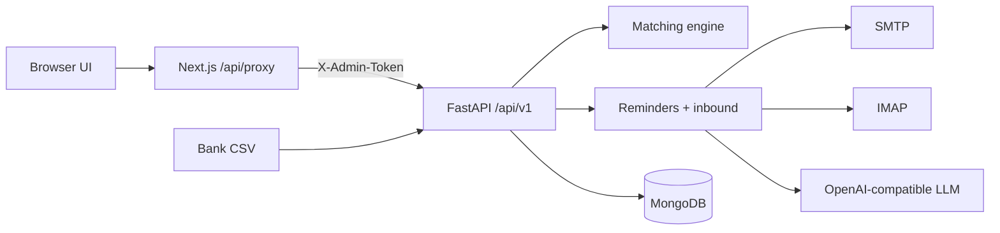

# AcmeCorp Accounts (Sonic AI Intern Assignment)

Take-home: **Part A** (org / customers / invoices), **Part B** (collections agent), **Part C** (bank reconciliation). Stack: FastAPI + Motor/MongoDB + Next.js App Router.

## Architecture



- Browser never holds `ADMIN_TOKEN` or `BACKEND_URL`.
- Money is stored as **integer minor units**; display uses `format_money`.
- “Today” for overdue uses `DEMO_TODAY` when set (else real local date).

## Run from scratch (clean clone)

Tested path on Linux with Docker + Python 3.12 + Node 20:

```bash
git clone <this-repo> && cd Sonic-AI-Intern-Assignment

# 1) Env
cp .env.example .env
# Optional but recommended for demos:
#   DEMO_TODAY=2026-11-05
#   ADMIN_API_TOKEN=<long random string>

cp frontend/.env.example frontend/.env.local
# BACKEND_URL=http://localhost:8000
# ADMIN_TOKEN must equal ADMIN_API_TOKEN

# 2) Mongo
docker compose up -d

# 3) Backend
cd backend
python3 -m venv .venv
source .venv/bin/activate
pip install -r requirements.txt
python -m app.scripts.seed
uvicorn app.main:app --reload --port 8000
# API docs: http://localhost:8000/docs

# 4) Frontend (new terminal)
cd frontend
npm install
npm run dev
# UI: http://localhost:3000
```

Health check:

```bash
curl -s http://localhost:8000/api/v1/health | jq
```

## Env var table

| Variable | Where | Purpose | Default |
|----------|-------|---------|---------|
| `ENV` | backend | `development` / `production` | `development` |
| `MONGODB_URI` | backend | Mongo URI | `mongodb://localhost:27017` |
| `MONGODB_DB` | backend | DB name | `acmecorp` |
| `ADMIN_API_TOKEN` | backend | Mutating API auth (`X-Admin-Token`) | `dev-admin-token` |
| `FRONTEND_ORIGIN` | backend | Exact CORS origin | `http://localhost:3000` |
| `DEMO_TODAY` | backend | Optional `YYYY-MM-DD` clock | unset |
| `SMTP_HOST` / `SMTP_PORT` | backend | Outbound SMTP | Gmail 587 |
| `SMTP_USER` / `SMTP_PASSWORD` | backend | Org mailbox + app password | empty |
| `IMAP_HOST` / `IMAP_PORT` | backend | Inbound IMAP | Gmail 993 |
| `IMAP_USER` / `IMAP_PASSWORD` | backend | Same org mailbox | empty |
| `EMAIL_FROM_NAME` | backend | From display name | AcmeCorp Accounts Team |
| `EMAIL_DRY_RUN` | backend | `true` → Mongo `email_outbox` only | `true` |
| `REMINDER_COOLDOWN_HOURS` | backend | Reminder anti-spam | `72` |
| `ENABLE_REMINDER_SCHEDULER` | backend | Daily reminder job | `false` |
| `ENABLE_INBOX_POLL` | backend | IMAP poll loop | `false` |
| `INBOX_POLL_SECONDS` | backend | Poll interval | `120` |
| `LLM_API_KEY` / `LLM_BASE_URL` / `LLM_MODEL` | backend | OpenAI-compatible chat | Gemini URL + flash |
| `LLM_MIN_CONFIDENCE` | backend | Below → Needs attention | `0.75` |
| `MAX_EMAIL_BODY_CHARS` | backend | Body size cap | `12000` |
| `ENABLE_EMBEDDINGS` | backend | Optional MiniLM | `false` |
| `ENABLE_LLM_MATCH_ASSIST` | backend | Optional LLM match assist | `false` |
| `BACKEND_URL` | frontend `.env.local` | Proxy upstream | — |
| `ADMIN_TOKEN` | frontend `.env.local` | Injected by proxy | — |

**Production:** `ENV=production` refuses default/short `ADMIN_API_TOKEN`.

## Gmail setup (two accounts)

1. **Org mailbox** → App Password → `SMTP_*` / `IMAP_*`.
2. **Customer mailbox** → set a seed customer’s `contact_email` to that address (Customers page).
3. Set `EMAIL_DRY_RUN=false` only when ready to send for real.
4. Configure `LLM_API_KEY` (+ base URL/model as needed).

## How to run tests

```bash
cd backend
source .venv/bin/activate
pytest -v -s
# Matching tables + mutation stress:
pytest tests/test_matching_eval.py tests/test_matching_holdout.py tests/test_matching_mutation.py -s
```

Requires Mongo on `localhost:27017` (`docker compose up -d`).

## API reference (examples)

All mutating routes need `X-Admin-Token: $ADMIN_API_TOKEN`.

### Part A

```bash
curl -s http://localhost:8000/api/v1/organization | jq
curl -s http://localhost:8000/api/v1/customers | jq 'length'
curl -s 'http://localhost:8000/api/v1/invoices?overdue_only=true' | jq '.[].invoice_number'
curl -s -X PATCH http://localhost:8000/api/v1/customers/C002 \
  -H "X-Admin-Token: $ADMIN_API_TOKEN" -H "Content-Type: application/json" \
  -d '{"contact_email":"you@gmail.com"}'
curl -s -X POST http://localhost:8000/api/v1/admin/reset \
  -H "X-Admin-Token: $ADMIN_API_TOKEN" -H "Content-Type: application/json" \
  -d '{"confirm":true}'
```

### Reconciliation (Part C)

```bash
curl -s -X POST http://localhost:8000/api/v1/reconciliation/upload \
  -H "X-Admin-Token: $ADMIN_API_TOKEN" \
  -F "file=@data/bank_statement_sample.csv"

curl -s http://localhost:8000/api/v1/reconciliation/statements/{id} \
  -H "X-Admin-Token: $ADMIN_API_TOKEN"

curl -s -X POST …/suggestions/{id}/approve -H "…" -d '{}'
curl -s -X POST …/approve -d '{"tds_mode":"leave_open"}'
curl -s -X POST …/approve -d '{"tds_mode":"close_tds"}'   # INR + shortfall == 10% subtotal
curl -s -X POST …/reject -d '{}'
curl -s -X POST …/choose -d '{"invoice_numbers":["INV-1002"]}'
```

Cross-upload fingerprint already applied → **409**.

### Collections (Part B)

```bash
curl -s -X POST http://localhost:8000/api/v1/collections/reminders/send \
  -H "X-Admin-Token: $ADMIN_API_TOKEN"
curl -s -X POST http://localhost:8000/api/v1/collections/inbox/check \
  -H "X-Admin-Token: $ADMIN_API_TOKEN"
curl -s http://localhost:8000/api/v1/collections/conversations -H "X-Admin-Token: $ADMIN_API_TOKEN"
curl -s http://localhost:8000/api/v1/collections/needs-attention -H "X-Admin-Token: $ADMIN_API_TOKEN"
curl -s -X PATCH …/needs-attention/{id} -d '{"draft":"…"}'
curl -s -X POST …/needs-attention/{id}/send -d '{}'
curl -s -X POST …/needs-attention/{id}/dismiss
```

## Design decisions & assumptions

1. **Money:** major units only at the JSON seed boundary; runtime is minor ints + `Decimal` math.
2. **Matching is local-first:** fuzzy aliases + amount/date gates; no statement → LLM. Prefer **no match** over a wrong match.
3. **TDS:** 10% of **subtotal**, **INR only**, decided at approve time (`close_tds` / `leave_open`).
4. **Overpayment:** refused; no unapplied-credit ledger.
5. **Fingerprint:** `sha256(date|narration|amount_minor|reference|currency)` blocks re-application across uploads.
6. **Collections:** facts (invoice lines, bank details) rendered by code templates; LLM writes prose only; deterministic validator is the last gate.
7. **Safety before LLM:** auto-replies/bounces, legal/dispute/extension/other-company keywords; LLM may only add caution.
8. **Unknown senders:** Needs attention, no company data in LLM context.
9. **Payment claims never mark invoices paid** — notes + optional evidence for reconciliation only.
10. **`DEMO_TODAY=2026-11-05`** assumed for seed overdue behaviour in demos/tests.

## Known limitations

- **Overpayment is refused; no unapplied-credit ledger.**
- Fingerprint blocks only **applied** rows; unapplied re-uploads may be re-suggested.
- Email evidence boost is capped (+5) and cannot create a match alone.
- Human Needs attention → Send warns on validator failures but still sends (human override).
- Schedulers off by default; Gmail IMAP can lag (click Check inbox again).
- `EMAIL_DRY_RUN=true` writes outbox docs instead of SMTP.
- Optional embeddings / LLM match assist are off and unused for grading.
- Single-process rate limits (not shared across replicas).

## Finished / not finished

| Area | Status |
|------|--------|
| Part A API + seed/reset + UI | **Finished** |
| Part C matching + API + review UI + fingerprint + holdout eval | **Finished** |
| Part B reminders + inbound + Needs attention UI + tests | **Finished** |
| Security checklist + regression tests | **Finished** |
| Bonus: payment-email ↔ statement evidence | **Finished** (capped boost) |
| README (this file) | **Finished** |
| `docs/explanation.md` + `docs/explanation.pdf` | **Finished** (`python scripts/build_explanation_pdf.py`) |
| `docs/video-script.md` | **Finished** |
| Live two-Gmail soak beyond dry-run | **Operator-dependent** (credentials) |

## Matching (short)

Weights/thresholds: `backend/app/services/matching/config.py`.

1. Normalize narration → payer + invoice hints  
2. Alias generation (legal suffix, abbreviations, contact initials)  
3. Similarity: token_set_ratio + Jaro-Winkler + char n-gram TF-IDF  
4. Candidates: open invoices; multi-invoice subset-sum (same customer/currency)  
5. Hard gates: unknown payer + no invoice # → none; amount-alone → none; wrong currency → none; payment before invoice_date → reject; conf &lt; 60 → none  
6. Soft top-3 alternatives on `none` for the reviewer  

**Self-authored eval sets:** held-out adversarial CSV `backend/tests/fixtures/eval_holdout.csv` (+ labels) and the mutation stress suite were written without peeking at thresholds.

**Stress test (mutations, seed 20261105):** 46 correct base rows → 261 mutations → **243 same / 18 none / 0 wrong**. Exact-tie siblings (same customer + amount, no unique hint) return type **none** with reason `ambiguous between INV-X/INV-Y` and both invoices in alternatives (`AMBIGUOUS_CONFIDENCE_CAP=59` &lt; review 60). Explicit invoice hints still resolve normally.
